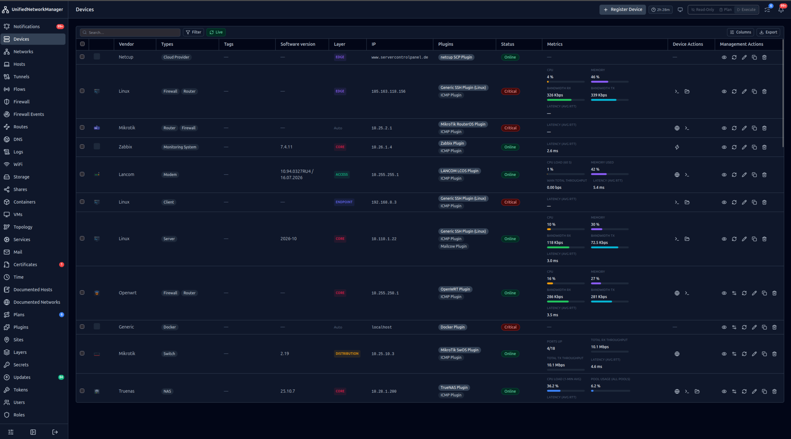
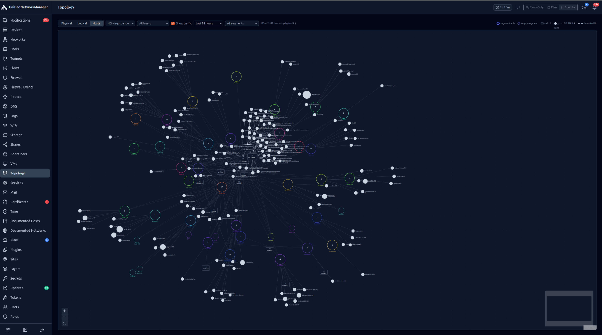
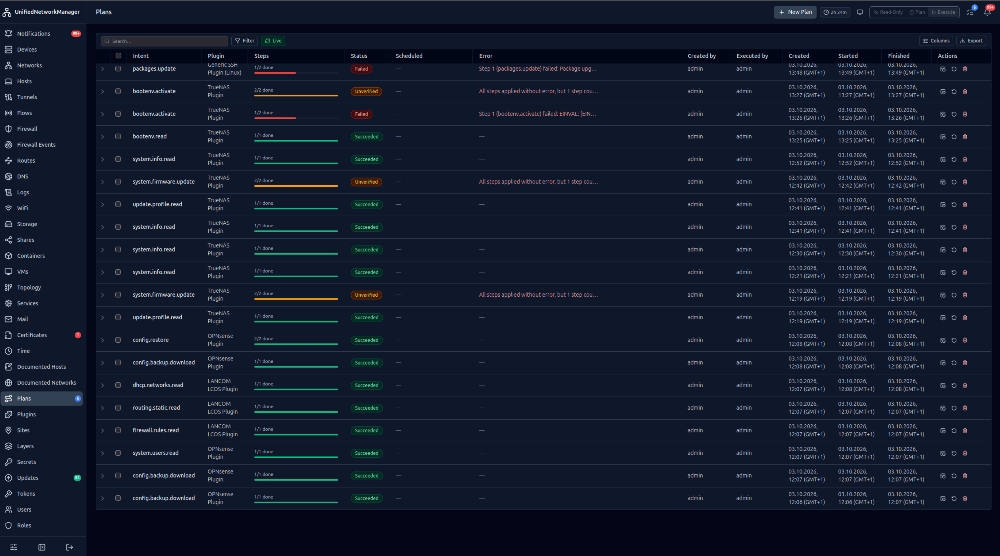
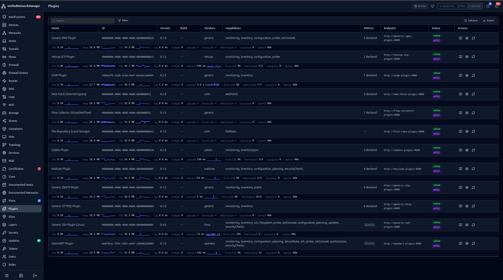
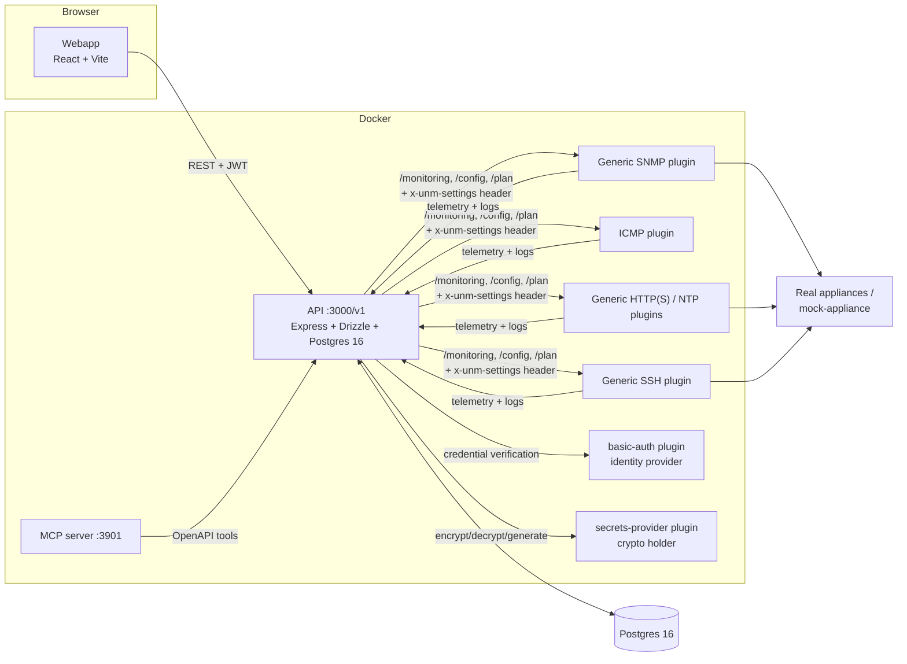

# UnifiedNetworkManager (UNM)

[](https://github.com/MichaelKirgus/UnifiedNetworkManager/actions/workflows/plugin-tests.yml)
[](https://github.com/MichaelKirgus/UnifiedNetworkManager/actions/workflows/ci.yml)
[](https://github.com/MichaelKirgus/UnifiedNetworkManager/actions/workflows/docker-publish.yml)
[](LICENSE.md)
[](https://nodejs.org/)
[](https://www.docker.com/)

Open-source network management and monitoring platform for mixed-vendor environments. A central control plane that manages devices through **pluggable vendor adapters** — each plugin is a small microservice speaking one common contract, so adding a new device family never means touching the core.

> ## ⚠️ Read this first
>
> **UNM is a management appliance — never expose the web UI to the public internet.** It holds credentials for every device it manages and can *write* their configuration. Keep it reachable only via VPN, or behind a reverse proxy with additional authentication (TLS termination + auth). Security has layers: even with best practices in place, direct exposure of an admin plane is how networks get owned.
>
> Also note: UNM is **not affiliated with any device vendor** — see [Trademark disclaimer](#trademark-disclaimer) at the bottom.

## Screenshots

One control plane for a mixed-vendor estate — here's what that looks like in practice.

| | |
| :---: | :---: |
|  |  |
| _**The Devices page** — every router, firewall, NAS and server in one table with live per-device metrics and the plugins managing each._ | _**Live topology** — hosts, VLANs and switches across your whole estate rendered as an interactive graph with a traffic overlay._ |
|  |  |
| _**Plans & configuration jobs** — audited, multi-step writes with per-step progress, verification status and a full error trail._ | _**The plugin fleet** — every discovered vendor adapter at a glance: capabilities, live self-metrics sparklines and mTLS transport state._ |

## Features

- **Open API** — vendor-neutral REST contract in [`openapi/`](openapi/unified-network-manager.openapi.yaml), validated at runtime on every request.
- **Plugin system** — vendor adapters are independent microservices that self-register with the API; a device can carry **multiple plugins at once**, each with its own credentials. All 28 shipped plugins: [docs/PLUGINS.md](docs/PLUGINS.md).
- **Authentication with RBAC + 2FA** — JWT auth, DB-backed roles, TOTP for privileged operations; credential verification delegated to the pluggable basic-auth identity provider.
- **Secrets management** — device credentials encrypted at rest by the pluggable secrets-provider plugin (the API only ever stores ciphertext); generatable types (WireGuard keys, tunnel PSKs, OpenVPN CA) creatable from the UI or as part of a plan.
- **Configuration workflows** — single-device config jobs plus multi-step [plans](docs/PLANS-AUTOMATIONS.md): dependencies, token substitution between step results, pre-write snapshots and secret provisioning.
- **Automations** — ITTT-style rules (schedule / metric / log / device-status / flow / update triggers → intents, webhooks or notifications) with cooldowns, deferral windows and a template catalog.
- **Cross-device inventory pages** — Networks, Hosts, Routes, Tunnels and Wi-Fi clients merged across all devices.
- **Flows & security insights** — sFlow/NetFlow visibility (top talkers, pairs, internet egress) with GeoIP + reverse-DNS enrichment; flow-based detectors (new destinations, port scans, egress baselines), IOC/threat-intel matching and syslog ingestion feed the Security page.
- **MCP server** — exposes the whole API to AI agents over the [Model Context Protocol](https://modelcontextprotocol.io); new endpoints appear as tools automatically ([docs/MCP.md](docs/MCP.md)).

## Architecture



- **Control plane API** (`api/`) — auth, RBAC, inventory, monitoring, config jobs, plans, secrets broker. Background workers (telemetry poll every 30 s, config-job executor, plan executor, log retention sweep) start only after the HTTP server has bound successfully.
- **Plugin runtime** — each plugin advertises itself via `/discover` (identity, capabilities, options, actions, device-model catalog). The API caches descriptors and injects effective settings as an `x-unm-settings` JSON header on every call it makes to a plugin.
- **Telemetry pipeline** — normalized metrics + inventory ride in one `telemetry` row per poll; the API fans inventory out into the cross-device `networks`, `hosts`, `routes`, and tunnel tables.

The repository contains `api/` (Express + Drizzle + Postgres), `webapp/` (React SPA), `plugins/` (28 vendor adapters), `packages/plugin-sdk/`, `mcp/` and the OpenAPI contract in `openapi/` — full layout, dev setup and build workflow: [docs/DEVELOPMENT.md](docs/DEVELOPMENT.md).

## Getting started

Prerequisites: Docker (with compose). That's it — every component ships as a pre-built image on the [GitHub Container Registry](https://ghcr.io), so running UNM needs no Node.js and no local build.

```bash
git clone https://github.com/MichaelKirgus/UnifiedNetworkManager.git
cd UnifiedNetworkManager
docker compose up -d
```

The default `docker-compose.yml` is the end-user deployment — every service is pulled pre-built from the [GitHub Container Registry](https://ghcr.io), no local build needed. For production, copy the annotated template to `.env` and change at least the values marked **MUST CHANGE** (`MASTER_KEY`, `CRYPTO_SALT`, `JWT_SECRET`, `POSTGRES_PASSWORD`, `PLUGIN_API_KEY`) — they are insecure dev defaults. Image overrides & tags, Postgres notes, RADIUS sidecar DB role, macvlan management VLAN and unprivileged containers: [docs/DEPLOYMENT.md](docs/DEPLOYMENT.md).

### First login

On a fresh deployment the API seeds an **admin** user (username `admin`, password `admin`). Sign in at <http://localhost:8080> — no `.env` file is needed, every variable has a sane default.

The first sign-in is **password-only**: you are then redirected into a mandatory setup wizard that forces you to

1. change the initial password, and
2. enroll a second factor (TOTP authenticator or passkey)

before you can use anything else. There is no skip — once the wizard completes, 2FA is required for every subsequent login of that account.

## Documentation

| Document | What it covers |
|----------|----------------|
| [docs/PLUGINS.md](docs/PLUGINS.md) | **Plugin catalog** — all 28 shipped plugins with supported vendors & devices, plus how the plugin model works (multi-IP addressing, log pipeline, multi-instance deployments) |
| [docs/PLUGIN-DEVELOPMENT.md](docs/PLUGIN-DEVELOPMENT.md) | The plugin developer guide — contract, SDK usage, settings loop, discovery, deployment |
| [docs/PERMISSIONS.md](docs/PERMISSIONS.md) | Full RBAC reference — every permission, the API route → permission map, inline gates and webapp page guards |
| [docs/INTENTS.md](docs/INTENTS.md) | Plan intents reference — the per-plugin building blocks plans are made of |
| [docs/DEPLOYMENT.md](docs/DEPLOYMENT.md) | Production deployment — `.env` hardening, Postgres notes, RADIUS DB role, macvlan management VLAN, unprivileged containers, reverse-proxy env vars, GHCR images & tags, scaling & HA |
| [docs/SECURITY.md](docs/SECURITY.md) | Security model overview + network-exposure guidance (keep UNM off the public internet) |
| [docs/MCP.md](docs/MCP.md) | MCP server (AI agent access) — endpoints, env vars and client config |
| [docs/PLANS-AUTOMATIONS.md](docs/PLANS-AUTOMATIONS.md) | Plans & configuration jobs + ITTT automations in depth |
| [docs/BACKUP-REPLICATION.md](docs/BACKUP-REPLICATION.md) | Backups, restore and cross-instance replication (incl. secret portability + dev → prod recipe) |
| [docs/RADIUS-FAILOVER.md](docs/RADIUS-FAILOVER.md) | FreeRADIUS sidecar — WiFi EAP-TLS, accounting and failover/replication |
| [docs/REVERSE-PROXY.md](docs/REVERSE-PROXY.md) | Remote access via nginx / Caddy / Cloudflare examples |
| [docs/DEVELOPMENT.md](docs/DEVELOPMENT.md) | Repository layout, hot-reload dev setup, build workflow and key API environment variables |

## Security model

RBAC (~58 permissions — full catalog in [docs/PERMISSIONS.md](docs/PERMISSIONS.md)), mandatory 2FA for privileged operations, secrets encrypted at rest by the pluggable secrets provider (the API only ever stores ciphertext), and long-lived API tokens with per-token permission narrowing.

> **Keep UNM off the public internet** — it holds credentials for every device and can write their configuration (firewalls included). Expose only via VPN or an authenticated reverse proxy (TLS termination + auth): [docs/SECURITY.md](docs/SECURITY.md) and [docs/REVERSE-PROXY.md](docs/REVERSE-PROXY.md).

Production hardening — `.env` MUST-CHANGE values, macvlan management VLAN (`UNM_DEFAULT_GATEWAY`), unprivileged containers (uid 1001) and the RADIUS sidecar DB role: [docs/DEPLOYMENT.md](docs/DEPLOYMENT.md).

## Plugins

Each plugin is an independent microservice that self-registers with the API on boot — UNM keeps no catalog of known plugins, so deploying a third-party adapter needs zero changes to the core. A device can carry multiple plugins at once; multi-IP addressing, the log pipeline and multi-instance deployments for remote sites are documented in [docs/PLUGINS.md](docs/PLUGINS.md). Building your own: [docs/PLUGIN-DEVELOPMENT.md](docs/PLUGIN-DEVELOPMENT.md).

## Plans, automations & backups

- **Plans** — audited multi-step writes with per-step dependencies, token substitution between step results and secret provisioning; single-device config jobs sit alongside them ([docs/PLANS-AUTOMATIONS.md](docs/PLANS-AUTOMATIONS.md)).
- **Automations** — ITTT-style rules (schedule / metric / log / device-status / flow / update triggers → intents, webhooks or notifications) with cooldowns and deferral windows.
- **Backups & replication** — section-based archives of UNM's own database plus one-way cross-instance sync ([docs/BACKUP-REPLICATION.md](docs/BACKUP-REPLICATION.md)).

## MCP server (AI agent access)

The `mcp/` service exposes the whole API to AI agents over the [Model Context Protocol](https://modelcontextprotocol.io) — every OpenAPI operation becomes a tool automatically, gated by the permissions of its API token. Endpoints, env vars and client config: [docs/MCP.md](docs/MCP.md).

## Development

Use `./setup.sh` for a hot-reload dev stack built from source. Build-order rules, the schema-change workflow (additive migrations apply at container boot; data-loss changes are refused without `--force`) and all key API environment variables: [docs/DEVELOPMENT.md](docs/DEVELOPMENT.md).

## Scaling & HA

The API runs as N replicas behind a load balancer with exactly one worker leader — election via Postgres advisory locks, automatic failover within 15 s, no external coordinator. Capacity guidance per fleet size: [docs/DEPLOYMENT.md](docs/DEPLOYMENT.md#scaling--ha).

## Trademark disclaimer

UnifiedNetworkManager (UNM) is an independent, open-source project. It has **no connection to, affiliation with, or endorsement by** any vendor whose devices it supports — including but not limited to OPNsense, MikroTik, LANCOM Systems, TrueNAS/iXsystems, FRITZ!Box (AVM), OpenWrt, Zabbix and Mailcow. All product names, trademarks and brands mentioned in this repository are the property of their respective owners and are used solely to identify compatible hardware and software — not to imply any partnership, sponsorship or official status.
