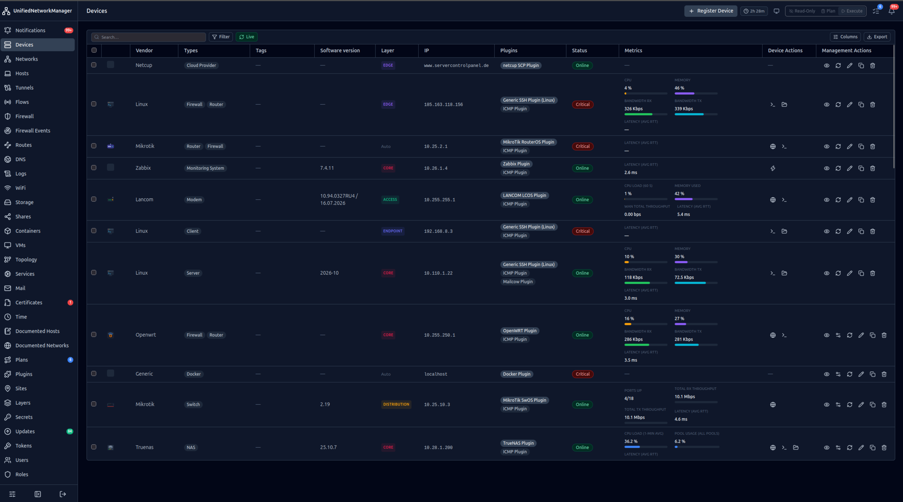
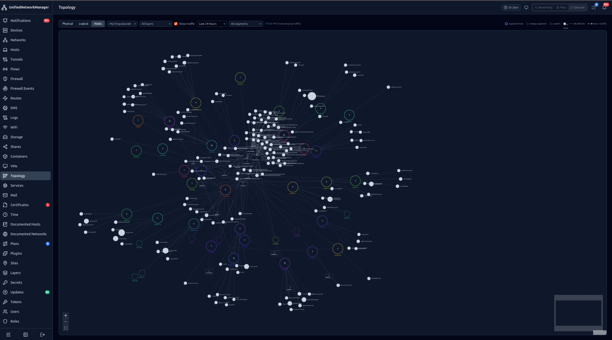
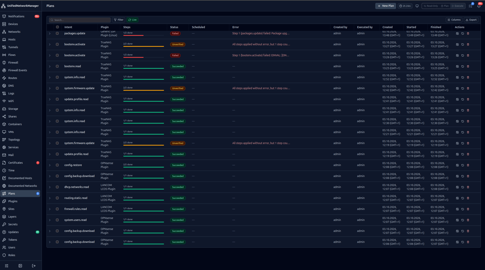
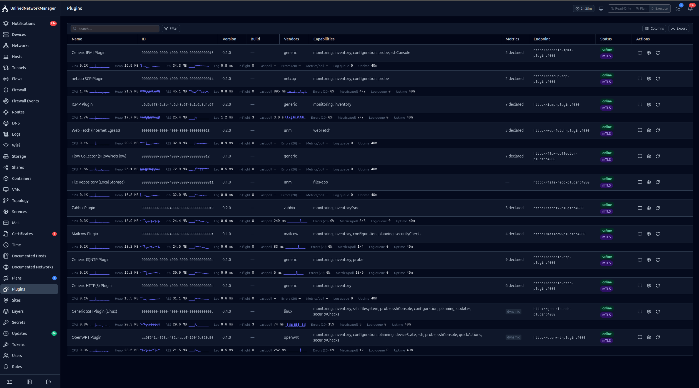
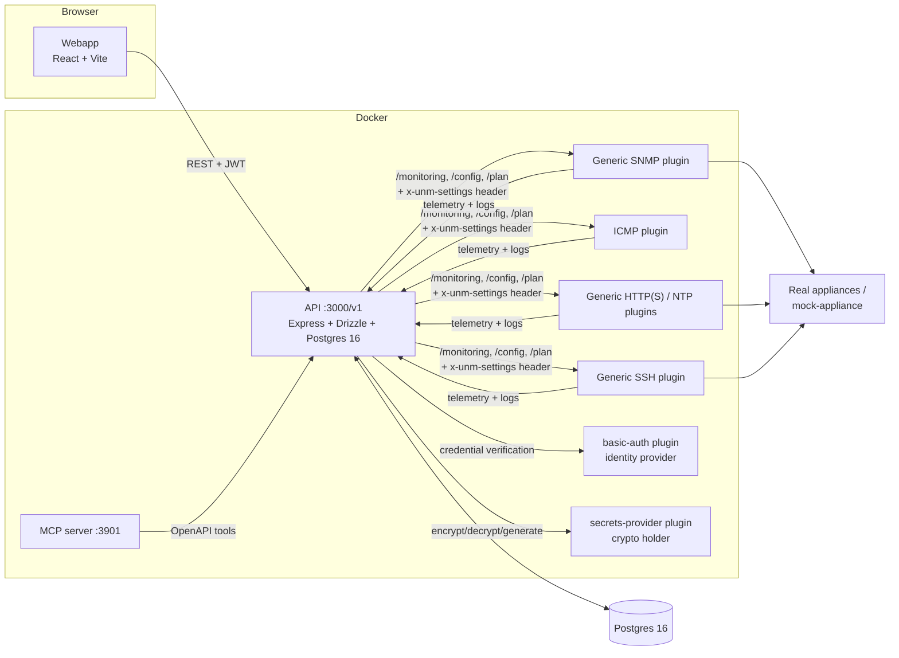

# UnifiedNetworkManager (UNM)

[](https://github.com/MichaelKirgus/UnifiedNetworkManager/actions/workflows/plugin-tests.yml)
[](https://github.com/MichaelKirgus/UnifiedNetworkManager/actions/workflows/ci.yml)
[](https://github.com/MichaelKirgus/UnifiedNetworkManager/actions/workflows/docker-publish.yml)
[](LICENSE.md)
[](https://nodejs.org/)
[](https://www.docker.com/)

Open-source network management and monitoring platform for mixed-vendor environments. A central control plane that manages devices through **pluggable vendor adapters** — each plugin is a small microservice speaking one common contract, so adding a new device family never means touching the core.

> ## ⚠️ Read this first
>
> **UNM is a management appliance — never expose the web UI to the public internet.** It holds credentials for every device it manages and can *write* their configuration. Keep it reachable only via VPN, or behind a reverse proxy with additional authentication (TLS termination + auth). Security has layers: even with best practices in place, direct exposure of an admin plane is how networks get owned.
>
> Also note: UNM is **not affiliated with any device vendor** — see [Trademark disclaimer](#trademark-disclaimer) at the bottom.

## Screenshots

One control plane for a mixed-vendor estate — here's what that looks like in practice.

| | |
| :---: | :---: |
|  |  |
| _**The Devices page** — every router, firewall, NAS and server in one table, with live per-device metrics (CPU, memory, bandwidth, latency) and the plugins managing each._ | _**Live topology** — hosts, VLANs and switches across your whole estate rendered as an interactive graph with a traffic overlay._ |
|  |  |
| _**Plans & configuration jobs** — audited, multi-step writes with per-step progress, verification status and a full error trail._ | _**The plugin fleet** — every discovered vendor adapter at a glance: capabilities, live self-metrics sparklines and mTLS transport state._ |

## Contents

- [Screenshots](#screenshots)
- [Features](#features)
- [Architecture](#architecture)
- [Repository layout](#repository-layout)
- [Getting started](#getting-started)
  - [First login](#first-login)
  - [For developers: hot-reload dev setup](#for-developers-hot-reload-dev-setup)
  - [Pre-built images (GHCR)](#pre-built-images-ghcr)
- [Security model](#security-model)
  - [Network exposure — keep it off the public internet](#network-exposure--keep-it-off-the-public-internet)
  - [Dedicated management VLAN (macvlan deployment)](#dedicated-management-vlan-macvlan-deployment)
  - [Unprivileged containers](#unprivileged-containers)
- [Device addressing (multi-IP)](#device-addressing-multi-ip)
- [Plugin model](#plugin-model)
  - [Plugin log pipeline](#plugin-log-pipeline)
  - [Multi-instance plugins (remote sites)](#multi-instance-plugins-remote-sites)
- [Plans & configuration jobs](#plans--configuration-jobs)
- [Backup & replication](#backup--replication)
- [MCP server (AI agent access)](#mcp-server-ai-agent-access)
- [Development workflow](#development-workflow)
  - [Key environment variables (API)](#key-environment-variables-api)
- [Scaling & HA](#scaling--ha)

## Features

- **Open API** — vendor-neutral REST contract in [`openapi/unified-network-manager.openapi.yaml`](openapi/unified-network-manager.openapi.yaml); the Express API validates every request against it at runtime (`express-openapi-validator`).
- **Plugin system** — vendor adapters are independent microservices discovered via mDNS/DNS-SD with an HTTP polling fallback. A device can carry **multiple plugins at once** (e.g. generic SNMP + a vendor plugin), each with its own credentials; exactly one is *primary*.
- **Authentication with RBAC + 2FA** — JWT auth, flat permission catalog, DB-backed roles, TOTP two-factor for privileged operations (config jobs and plan execution require an enrolled authenticator). The API itself is a pure auth broker: credential verification is delegated to the pluggable **basic-auth** identity provider.
- **Secrets management** — device credentials are encrypted at rest by the pluggable **secrets-provider** plugin (the crypto holder); the API only ever stores ciphertext. Generatable secret types (WireGuard key pairs, tunnel PSKs, OpenVPN CA/cert/key) can be created and regenerated from the UI or as part of a plan.
- **Configuration workflows** — single-device config jobs plus multi-step **plans**: ordered steps with dependencies, token substitution between step results (`${steps[N].result.details.<key>}`), automatic best-effort config snapshots before writes (undoable plans), and secret provisioning wired into the plan lifecycle.
- **Cross-device inventory pages** — Networks (logical subnets/VLANs merged across devices), Hosts (one row per MAC, ARP/NDP/DHCP/Wi-Fi sources), Routes (static + connected + dynamic, with gateway health enrichment), Tunnels (WireGuard/IPsec/OpenVPN live state: peer addresses, handshake age, transfer rates), and Wi-Fi clients.
- **Plugin log pipeline** — plugins ship structured logs to the API (`POST /plugin/logs`); entries are retained for a configurable number of days and browsable globally or per device in the webapp (gated by its own `logs:read` permission). Emission is on by default and can be switched off globally or per device.
- **Plugin self-metrics** — every plugin auto-serves `GET /metrics` (CPU%, heap/RSS memory, event-loop lag, in-flight polls, last-poll duration + error rate, emitted metric count, log queue depth); the API samples it every 30 s and the webapp shows per-plugin runtime health with history sparklines — for spotting overloaded plugins or growing telemetry payloads.
- **MCP server** — exposes the whole API to AI agents over the [Model Context Protocol](https://modelcontextprotocol.io); new endpoints appear as tools automatically.

## Architecture



- **Control plane API** (`api/`) — auth, RBAC, inventory, monitoring, config jobs, plans, secrets broker. Background workers (telemetry poll every 30 s, config-job executor, plan executor, log retention sweep) start only after the HTTP server has bound successfully.
- **Plugin runtime** — each plugin advertises itself via `/discover` (identity, capabilities, options, actions, device-model catalog). The API caches descriptors and injects effective settings as an `x-unm-settings` JSON header on every call it makes to a plugin.
- **Telemetry pipeline** — normalized metrics + inventory ride in one `telemetry` row per poll; the API fans inventory out into the cross-device `networks`, `hosts`, `routes`, and tunnel tables.

## Repository layout

| Path | What it is |
|------|-----------|
| `api/` | Express API service (Drizzle ORM + Postgres), OpenAPI-validated, JWT/RBAC/TOTP auth, workers for telemetry/config jobs/plans/log retention |
| `webapp/` | React 18 + Vite + Tailwind SPA (login, devices, plans, networks, hosts, routes, tunnels, Wi-Fi, logs, plugins, secrets, sites, users, roles, tokens) |
| `packages/plugin-sdk/` | Shared TypeScript SDK for plugins (`@unm/plugin-sdk`): HTTP server scaffolding (incl. auto-mounted self-metrics `/metrics`), settings reading, API client, structured logger |
| `packages/snmp-client/` | Shared net-snmp CLI wrapper used by the SNMP + LANCOM plugins |
| `plugins/` | One microservice per vendor adapter — 24 plugins in total. The full list with supported vendors & devices lives in [docs/PLUGINS.md](docs/PLUGINS.md); `_template/` is the scaffold for new plugins |
| `plugins/basic-auth/` | Identity provider plugin — local users + TOTP verification on behalf of the API (swappable via `AUTH_PLUGIN_ID`) |
| `plugins/secrets-provider/` | Secrets provider plugin — encryption at rest (owns `MASTER_KEY`) + key/cert generation (swappable via `SECRETS_PLUGIN_ID`) |
| `mcp/` | MCP server exposing the OpenAPI operations as tools (+ read-only SQL & plugin probes on a gated debug endpoint) |
| `openapi/` | The OpenAPI contract — single source of truth for the public API surface |
| `scripts/` | Mock OPNsense appliance + TLS material, plan e2e test suite |
| `docs/PLUGINS.md` | **Plugin catalog** — every shipped plugin with its supported vendors & devices |
| `docs/PLUGIN-DEVELOPMENT.md` | **The plugin developer guide** — contract, SDK usage, settings loop, logging, discovery, deployment |
| `docs/PERMISSIONS.md` | **Permission catalog & access control** — full RBAC reference: every permission, the API route → permission map, inline gates and webapp page guards |

## Getting started

Prerequisites: Docker (with compose). That's it — every component ships as a pre-built image on the [GitHub Container Registry](https://ghcr.io), so running UNM needs no Node.js and no local build.

```bash
git clone https://github.com/MichaelKirgus/UnifiedNetworkManager.git
cd UnifiedNetworkManager
docker compose up -d
```

The default `docker-compose.yml` is the end-user deployment: same services, env vars and volumes as the dev file — every locally-built service is pulled from GHCR instead. Overrides (`.env` or environment):

| Variable | Default | Effect |
|----------|---------|--------|
| `UNM_IMAGE_TAG` | `dev` | Image tag to pull — use a release tag like `v0.1.0` for stable deployments, or `nightly` for the latest pre-release build |
| `UNM_REGISTRY` | `ghcr.io/michaelkirgus/unifiednetworkmanager` | Registry prefix (self-mirroring) |
| `UNM_WEB_PORT` | `8080` | Host port the webapp is published on |

The **MCP server is not exposed to the host by default** — it carries an API token with full agent capabilities, so publishing it on all interfaces is a deliberate choice. If you need remote MCP access, add your own mapping (e.g. `UNM_MCP_PORT=8081`) behind auth or a reverse proxy.

For a production deployment, copy the annotated template to `.env` and change at least the values marked **MUST CHANGE** (`MASTER_KEY`, `CRYPTO_SALT`, `JWT_SECRET`, `POSTGRES_PASSWORD`, `PLUGIN_API_KEY`) — they are insecure dev defaults:

```bash
cp .env.example .env
# edit .env → set a strong MASTER_KEY (openssl rand -hex 32), CRYPTO_SALT, JWT_SECRET,
#              POSTGRES_PASSWORD, PLUGIN_API_KEY
docker compose up -d
```

Tear down with `docker compose down` (add `-v` to also remove the Postgres volume).

**Postgres is not published to the host** — api/mcp reach it over the internal compose network only. If you need psql-from-host, add a loopback-only mapping (`"127.0.0.1:5432:5432"`) rather than `"5432:5432"`. Note that `POSTGRES_USER/PASSWORD/DB` are applied when the data volume is first initialized; to rotate credentials on an existing deployment, run `ALTER USER <user> PASSWORD '<new>';` inside Postgres and set the same value in `.env`.

### First login

On a fresh deployment the API seeds an **admin** user (username `admin`, password `admin`). Sign in at <http://localhost:8080> — no `.env` file is needed, every variable has a sane default.

The first sign-in is **password-only**: you are then redirected into a mandatory setup wizard that forces you to

1. change the initial password, and
2. enroll a second factor (TOTP authenticator or passkey)

before you can use anything else. There is no skip — once the wizard completes, 2FA is required for every subsequent login of that account.

### For developers: hot-reload dev setup

If you're working on UNM itself, use `setup.sh` instead — it needs Node.js ≥ 20 and builds everything from source (it works against `docker-compose.dev.yml`, which carries the `build:` blocks). The script detects whether you can reach the Docker daemon without sudo and only escalates when truly needed.

```bash
./setup.sh
```

This installs all dependencies (`make setup`), starts Postgres, syncs the schema (`drizzle-kit push`), builds the shared packages + plugins in parallel (`make build`), starts every plugin container with `--build`, then runs the API and webapp as hot-reloading dev servers. It blocks until you press Enter; teardown (dev servers + containers) happens automatically on exit/Ctrl+C.

Other targets: `make up|down|restart`, `make stop-api|stop-web`, `make clean` (removes containers **and** volumes).

On first boot the API seeds an **admin** user (password `admin`) — see [First login](#first-login): the initial sign-in is password-only and a mandatory setup wizard then forces a new password + second-factor enrollment. Accounts without an enrolled second factor cannot pass 2FA at all, so they are locked out of 2FA-gated endpoints (config jobs, plan execution) until one is enrolled.

### Pre-built images (GHCR)

Every component is published to the [GitHub Container Registry](https://ghcr.io) after the plugin contract suite passes. All packages are set to **public** visibility on GHCR, so pulling needs no `docker login`. The standard `docker-compose.yml` (end-user deployment, no build step) is **generated** from `docker-compose.dev.yml` by `scripts/generate-registry-compose.cjs` — change the dev file and regenerate; never edit the generated one by hand. Image names follow `ghcr.io/michaelkirgus/unifiednetworkmanager/<service>`, where `<service>` is the compose service name (`api`, `webapp`, `mcp`, `unm-ca`, and every `*-plugin`):

```bash
docker pull ghcr.io/michaelkirgus/unifiednetworkmanager/api:dev
```

Tag scheme: **branch pushes** are tagged with the branch name (`main` → `dev`), and **release tags** (`v0.1.0`) additionally move `latest`. So `latest` always points at the newest stable release, never at dev-branch builds — pin `:latest` for stable deployments or a version tag to be explicit.

Two automated lanes sit on top of that (see `.github/workflows/docker-publish.yml`):

- **Stable releases** — pushing a strict semver tag publishes all images tagged with it *and* creates the matching GitHub Release (after the plugin contract suite passes):
  `git tag v0.2.0 && git push origin v0.2.0`
- **Nightly pre-releases** — a daily scheduled build of `main` (or manual dispatch) publishes images tagged `nightly-<YYYYMMDD>` plus rolling `nightly`, and creates a dated GitHub **pre-release**. Pre-releases never move `latest`.

### Reverse proxy (remote access)

The supported way to reach UNM remotely is **TLS termination + auth at a reverse proxy** in front of the stack — see [docs/REVERSE-PROXY.md](docs/REVERSE-PROXY.md) for full nginx / Caddy / Cloudflare examples. Three env vars make it work:

| Variable | Default | Effect |
|----------|---------|--------|
| `UNM_TRUST_PROXY` | *(off)* | **Required behind any proxy.** Trusts `X-Forwarded-For` so rate limiting buckets on the **real client IP** instead of the proxy's address. Set to `1` for a single proxy hop, `N` for N hops, or a CIDR list / named policy (`loopback`, …). Without it, every proxied request is rejected with 500 — the rate limiter refuses untrusted `X-Forwarded-For` headers by design. |
| `UNM_CLIENT_IP_HEADER` | *(off)* | Explicit header carrying the client IP (e.g. Cloudflare's `CF-Connecting-IP`). Wins over `X-Forwarded-For`; only set it if the proxy is the sole path to the API. |
| `UNM_WEBAPP_API_URL` | `/v1` (relative) | The URL the *browser* uses for the API, baked into the webapp at build time. Pre-built images default to same-origin (`/v1`) — one public hostname serves UI + API, no CORS. Set an absolute URL only for cross-origin setups (e.g. dev: `http://localhost:3000/v1`); rebuild the webapp image after changing it. |

The recommended layout is **same-origin**: one public hostname serves the webapp and proxies `/v1/*` to the API, so there's no CORS configuration and the SSH-console WebSocket works with zero extra client setup — which is exactly what the pre-built images ship by default.

## Security model

- **RBAC** — flat permission catalog (`api/src/auth/permissions.ts` is the single source of truth; `GET /v1/permissions` serves it to the UIs). Users carry their effective permissions in JWT claims; roles are DB-backed bundles unioned into explicit grants at login time. New permissions added to the catalog are **backfilled onto existing admin users and the built-in admin role** on API start, so upgrades never lock admins out.
- **2FA (TOTP)** — required for privileged operations (`configs:apply`); enrollment is per-user via the My Account page or by an admin with `users:manage-credentials`.
- **Secrets** — values are encrypted by the secrets-provider plugin; the API stores only ciphertext and never sees plaintext. The webapp shows metadata only.
- **SNMP transport** — SNMP queries run in-process over native UDP (`@unm/snmp-client` on the `net-snmp` npm package); credentials (community strings, USM passphrases) are never passed as command-line arguments or written to logs. DES privacy is rejected at credential-validation time (Node ≥17 OpenSSL dropped it) — use AES.
- **API tokens** — long-lived bearer tokens (`unm_…`) for agents/scripts, self-service on the Tokens page or `POST /v1/tokens`, with per-token permission narrowing.

The full catalog — all ~58 permissions, the API route → permission map, inline gates (secrets personal area, self-vs-other credential ops) and webapp page guards — is documented in [docs/PERMISSIONS.md](docs/PERMISSIONS.md). Headline entries:

| Permission | Grants |
|------------|--------|
| `devices:read` / `devices:write` | View devices & telemetry; create/update/delete devices and plugin assignments |
| `configs:apply` | Submit configuration jobs / execute plans (requires 2FA) — gates *all* plan writes |
| `secrets:read` / `secrets:write` / `secrets:self-write` | Manage secrets globally vs. your own personal secret area (metadata only — values stay encrypted) |
| `users:*` | View users; edit roles/permissions & manage roles; create users; reset passwords and manage 2FA of other users (`manage-credentials`) or your own account (`self-credentials`) |

### Network exposure — keep it off the public internet

> **UNM is a management appliance. The web UI must never, ever be made available on the public internet.**
>
> It authenticates as *admin* to every device it manages and can rewrite their configuration (firewalls included). Exposing it directly means handing an attacker your entire network's keys.
>
> **Only expose it via:**
>
> - a **VPN** (WireGuard/IPsec/OpenVPN — UNM itself can plan those for you), or
> - a **reverse proxy with additional authentication** in front (TLS termination + auth, e.g. an SSO/OAuth proxy or mutual TLS), ideally combined with source-IP allow-listing.
>
> Security has layers: even if every best practice above is applied, each layer only matters while the others hold. A single vulnerability — in UNM, its dependencies, or a misconfigured proxy — becomes fatal when the admin plane sits directly on the internet. Treat "reachable from anywhere" as an incident, not a convenience.

### Dedicated management VLAN (macvlan deployment)

For production you typically want every UNM container to be a first-class citizen of a dedicated management VLAN instead of hiding behind Docker's NAT bridge. All images built from this repository ship with an entrypoint wrapper (`scripts/docker-entrypoint.sh`) that installs a default route when the optional environment variable **`UNM_DEFAULT_GATEWAY`** is set — it is already wired into every service in `docker-compose.dev.yml`, and empty/unset means pure passthrough, so normal bridge deployments are unaffected.

1. Create the macvlan network once on the host (parent = your management NIC):
   ```bash
   docker network create -d macvlan \
     --subnet 192.168.50.0/24 --gateway 192.168.50.1 \
     -o parent=enp3s0 -o mode=bridge unm-vlan
   ```
   `mode=bridge` keeps host↔container reachability (plain macvlan blocks it by design — your healthchecks and curl-from-host debugging would break).
2. Set the gateway in `.env`: `UNM_DEFAULT_GATEWAY=192.168.50.1`
3. Uncomment the top-level `networks:` block in `docker-compose.dev.yml` (it documents itself) and give every service a static IP, e.g.
   ```yaml
   api:
     networks:
       default:            # keep → NAT stays as fallback for internet egress
       unm-vlan:
         ipv4_address: 192.168.50.10
   ```

Notes:
- **Hybrid vs macvlan-only.** Keeping the implicit `default` bridge attached means traffic to your VLAN goes out the macvlan interface (most-specific route) while everything else still NATs through the host. Dropping `default:` makes ALL egress flow via your gateway — which then needs upstream routing/NAT itself.
- **Service-name URLs keep working.** Docker's embedded DNS resolves names of containers sharing a user-defined network, macvlan included — so `ADVERTISED_ENDPOINT=http://file-repo-plugin:4080`, `UNM_API_URL=http://api:3000/v1` and the ACME directory default need no changes. Just don't mix service names and VLAN IPs for the same endpoint: plugin mTLS leaf certs get their SAN from the host of `ADVERTISED_ENDPOINT`, so URL and certificate must match.
- **Inter-container traffic transits the physical segment** on macvlan — expected for a management stack, but it shows up on the wire.
- The wrapper never blocks startup: if no suitable interface is found or the route cannot be written (missing `CAP_NET_ADMIN`), it logs to stderr and continues. `UNM_GW_IFACE` forces the interface instead of auto-detect (which skips `lo` and Docker's 172.16/12 bridge range).

### Unprivileged containers

Every UNM image runs its application as a dedicated unprivileged user **`app`** (uid/gid `1001`) by default — the entrypoint wrapper (`scripts/docker-entrypoint.sh`, PID 1) performs all root-only work first, then drops privileges via a dependency-free Node helper (`scripts/unm-privdrop.js`). The CA container already ran as its own non-root user; this extends that to the API, MCP server and every plugin.

What the wrapper does at boot (all steps best-effort — a failure logs to stderr and never blocks startup):
1. **Default gateway** — see [macvlan deployment](#dedicated-management-vlan-macvlan-deployment) above (`UNM_DEFAULT_GATEWAY`).
2. **Data-dir ownership** — chowns the paths listed in `UNM_CHOWN_PATHS` (set per service in `docker-compose.dev.yml`) to `1001:1001`, so persistent volumes created while running as root keep working after the drop.
3. **Privilege drop** — joins any host docker group (`UNM_DOCKER_GID`), then drops to `app` and re-execs the app with stdio inherited and SIGTERM/SIGINT forwarded (so `docker stop` stays graceful).

Environment variables (all wired into every service in `docker-compose.dev.yml`; set them in `.env`):

| Variable | Effect |
|----------|--------|
| `UNM_RUN_AS_ROOT=1` | Explicit opt-out: skip the privilege drop and run as root (e.g. for rollback). |
| `UNM_SKIP_CHOWN=1` | Skip the runtime data-dir chown entirely — use it for huge byte stores you pre-chowned once (`chown -R 1001:1001 <volume>`), so boot stays instant. |
| `UNM_DOCKER_GID=<gid>` | Join this host group (e.g. `id -g docker`) as a supplementary group of `app`, so a mounted `/var/run/docker.sock` (owned `root:<gid>`) is accessible after the drop — needed by the docker plugin's socket transport. |
| `UNM_DOCKER_UID=<uid>` | Run the app under this uid instead of 1001, e.g. to match an existing host user that owns bind-mounted data dirs. |

Notes:
- **Existing volumes.** If you upgrade a running deployment, your data volumes are still root-owned — on first boot after the switch the wrapper chowns them once (that's what `UNM_CHOWN_PATHS` is for). For large stores, stop the stack and pre-chown instead: `chown -R 1001:1001 /var/lib/docker/volumes/<unm-stack>_filerepo-plugin/_data`, then set `UNM_SKIP_CHOWN=1`.
- **Shared CA volume.** `/data/ca` is shared between the API (writes `ca.json`) and the CA container (`step`, uid 1000, owns its state DB). It is group-writable for gid 1001 with setgid in the CA image — no runtime chown needed or wanted there.
- **No extra capabilities.** The ICMP plugin's `ping` works unprivileged (busybox uses SOCK_DGRAM ICMP sockets); nothing in the stack needs `NET_ADMIN` except the optional macvlan default-route step, which degrades gracefully without it.

## Device addressing (multi-IP)

Each device has exactly one **primary address** (`managementAddress`) plus any number of **secondary IPs**. All addresses must be a bare IPv4 literal, an IPv6 literal, or a DNS name — no scheme (`https://…`), because choosing the transport is each plugin's own decision.

- The primary is set at creation and edited via `PATCH /devices/{id}`; secondaries are managed with `GET/POST /devices/{id}/ips` and `DELETE /devices/{id}/ips/{ipId}` (mirrors the plugin-assignment pattern).
- Every `/monitoring` and `/config` call to a plugin carries **all** addresses as `ipAddresses: [{ address, isPrimary }]`, so plugins can reach secondary interfaces when they need to.
- Transport handling (TLS vs plaintext, self-signed certificates) lives in the **plugin**, not on the device — e.g. the OPNsense plugin's `transport` option (`auto` = HTTPS with self-signed accepted, `https`, or `http`).

## Plugin model

Each plugin is responsible for one or more `vendor/deviceType` combinations and advertises capabilities:

- `monitoring` (health/metrics/events)
- `inventory` (facts/interfaces/modules — propagated into the cross-device pages)
- `configuration` (read/apply/reconcile actions)
- `planning` (multi-step, multi-device plan intents with a step catalog)
- `secretsProvider` / `identityProvider` (the two broker plugins; swappable via `SECRETS_PLUGIN_ID` / `AUTH_PLUGIN_ID`)

Plugins are discovered automatically: every plugin SELF-REGISTERS with the API on boot (`POST /v1/plugin/register`, SDK `startRegistration`) using its `UNM_API_URL` + `PLUGIN_API_KEY`, and mDNS/DNS-SD is a second path where multicast reaches. UNM keeps no catalog of known plugins — deploying a third-party plugin needs zero changes to the main app (see [`docs/PLUGIN-DEVELOPMENT.md`](docs/PLUGIN-DEVELOPMENT.md) §1). The full developer guide, including the settings loop, credential slots, device-model catalogs, and the logging pipeline, lives in that document.

### Plugin log pipeline

Every plugin ships structured logs to `POST /plugin/logs` (shared `x-plugin-api-key`, self-reported `pluginId`). Entries land in `plugin_logs` with level, message, optional JSON context and device association; a retention worker deletes rows older than `LOG_RETENTION_DAYS` (default 7) hourly. The webapp shows them on the global **Logs** page and per device in Device Detail — both gated by `logs:read`.

Emission is **on by default** via the standard settings loop: each plugin declares a boolean `logToApi` option, so it can be switched off globally (Plugins → Configure) or overridden per device without redeploying anything. The SDK's `createPluginLogger()` batches entries (2 s flush), queues up to 500 with drop-oldest backpressure, and degrades silently when the API is unreachable — logging never blocks a poll cycle.

### Multi-instance plugins (remote sites)

Every plugin supports running **multiple instances of the same type** — e.g. one ICMP or SNMP plugin at each remote site, all reporting into a single UNM instance. Each instance registers as its own plugin row and can be assigned to devices independently.

Two optional environment variables control this:

| Variable | Effect |
|----------|--------|
| `PLUGIN_INSTANCE_ID` (e.g. `site-a`) | Makes the advertised identity unique (`<plugin-uuid>:site-a`). Without it, two instances of the same plugin type would collide into one registration. |
| `PLUGIN_DISPLAY_NAME` (optional) | Overrides the displayed name. If unset, the instance id is appended automatically: `ICMP Plugin (site-a)`. |

With neither set, behavior is exactly as before — single-instance deployments are unaffected. A commented example lives in `docker-compose.yml`. Notes: each instance needs a unique `ADVERTISED_ENDPOINT` (and self-registers independently on boot); settings are per-instance; changing an id/name just restarts it and the old registration goes offline like any stopped plugin.

## Plans & configuration jobs

- **Config jobs** — single-device action submissions (`POST /devices/:deviceId/config-jobs` with an explicit `pluginId`), executed by the config-job worker against that plugin assignment. Require `configs:apply` + 2FA.
- **Plans** — multi-step workflows with per-step dependencies, reordering (cycle-checked while draft/ready), and `${steps[N].result.details.<key>}` token substitution from earlier step results. The executor runs one plan at a time, persists the *resolved* input of each step before dispatch, honors `bestEffort` flags, and marks orphaned executing plans failed on startup. Plan creation can **provision secrets** (e.g. WireGuard key pairs) through the secrets provider with rollback on failure; provisioned material is referenced by id in steps and never stored in plaintext anywhere.
- E2E test suite: `scripts/e2e-plans.ts` against the mock OPNsense appliance (`docker compose --profile test up -d mock-appliance`; the service is hidden behind the `test` profile so productive `up`s never start it).

## Backup & replication

The **Backups** page (gated on the `instance:backup` permission) manages UNM's own database — not device configs:

- **Backups** are section-based gzip-compressed JSON archives (`.unmbak.gz`). Sections: `identity` (users/roles/policies), `settings`, `devices` (+plugins/secrets), `documented` (planned networks/hosts), `plans`, and `liveInventory` (regenerable telemetry — only in the *All* preset). Presets bundle sections; any combination works. Deliberately excluded from every backup: API tokens, passkeys, live telemetry/logs/events and the plugin registry cache.
- **Destinations** are per-backup: the local volume (`unm-backups` → `/data/backups`, override with `UNM_BACKUP_VOLUME`) or a registered file-repo instance (bytes content-addressed there; the backup is bound to exactly one instance — no fallback to a sibling).
- **Restore** is a safe merge: rows are upserted by primary key, and rows absent from the archive are never deleted. The webapp walks upload/stored → manifest preview → per-section report.
- **Replication** syncs portable config (everything except `liveInventory`) one-way to/from a peer instance using a peer API token that carries `instance:backup` there. Targets support manual *Sync now* and an optional interval (leader-gated scheduler). A default exclusion list strips stack-dependent settings (`instanceName`, update feed, provider bindings, …) before sending/applying — editable per target.

**Cross-instance secret portability:** device secrets are encrypted with a key derived from `MASTER_KEY` + `CRYPTO_SALT`. For replicated/restored secrets to decrypt on the peer, both instances MUST run with identical values for both variables (set them in each stack's `.env`).

**Dev → prod recipe:** 1) create an API token on **prod** with only `instance:backup` (Tokens page); 2) on **dev**, Backups → Replication → *Add target* (push, that URL + token, optional interval); 3) *Sync now*, then watch the scheduler. Verify `instanceName`/update-feed settings were NOT overwritten on prod.

## MCP server (AI agent access)

The `mcp/` service exposes the UNM API to AI agents via the [Model Context Protocol](https://modelcontextprotocol.io). It reads the OpenAPI spec at startup and turns every operation into a tool — new API endpoints appear automatically. The container serves two Streamable-HTTP endpoints on port **3901**:

| Endpoint | Purpose |
|----------|---------|
| `POST /mcp` | Production-safe: OpenAPI operations only. What an agent can do is controlled entirely by the permissions of its API token — create a scoped token (e.g. read-only) on the **Tokens** page and pass it as `UNM_API_TOKEN`. |
| `POST /debug/mcp` | Extended debug for diagnosing UNM itself: adds `query_database` (single read-only SELECT/WITH statement, max 200 rows) and `plugin_probe` (live `/healthz` + `/discover` of every plugin endpoint). Requires `Authorization: Bearer <MCP_DEBUG_KEY>`. |

**Environment variables:**

| Variable | Effect |
|----------|--------|
| `UNM_API_TOKEN` | Long-lived API token for the OpenAPI tools — **required**. Create it on the Tokens page (or `POST /v1/tokens`). |
| `UNM_API_BASE` | Base URL of the API. Defaults to `http://localhost:3000/v1`; the container uses `http://api:3000/v1`. |
| `MCP_DEBUG_KEY` | Bearer key gating `/debug/mcp` (default in compose: `dev-mcp-debug-key`). |
| `MCP_KEY` | Optional — when set, also gates the plain `/mcp` endpoint. |
| `DATABASE_URL` | Postgres connection used by the debug SQL tool only (same DB as the API; rendered from the same `POSTGRES_*` vars in compose). |

**VS Code MCP client config** (remote/HTTP transport):

```jsonc
{
  "mcpServers": {
    "unm": {
      "url": "http://localhost:3901/mcp"
    },
    "unm-debug": {
      "url": "http://localhost:3901/debug/mcp",
      "headers": { "Authorization": "Bearer dev-mcp-debug-key" }
    }
  }
}
```

The same server also runs in **stdio mode** without Docker (client-launched, production-safe tools only): `node mcp/dist/index.js` with `UNM_API_TOKEN` set — no `MCP_PORT` needed.

## Development workflow

- **Build order matters**: `@unm/plugin-sdk` and `@unm/snmp-client` must build first — npm `file:` dependencies are *copied* into each consumer's `node_modules`, so `make build` refreshes those copies before fanning out all plugin builds in parallel. After editing a shared package, always run `make build`.
- **Type-check**: `cd api && npx tsc --noEmit`, same for `webapp/` and each plugin; or just `make build`.
- **OpenAPI is enforced**: every new public route must be added to `openapi/unified-network-manager.openapi.yaml` — the validator 404s undocumented paths. Structural check: `node validate-openapi.cjs`.
- **Schema changes**: idempotent DDL in `initDb()` (`api/src/db.ts`) + `drizzle-kit push`; keep `schema.ts` composite-PK names equal to the live Postgres constraint names.
- **Smoke tests**: `cd plugins/opnsense && ../../node_modules/.bin/tsx smoke-test.ts` (same for `plugins/mikrotik-swos`).
- **Plugin images always rebuild from source** (`docker compose up -d --build <service>`) — reusing stale images silently serves old code.

### Key environment variables (API)

| Variable | Default | Effect |
|----------|---------|--------|
| `JWT_SECRET` | `dev-secret` | JWT signing key. Set a random value in `.env` for production (compose reads it via `${JWT_SECRET:-dev-secret}`) |
| `DATABASE_URL` | built from `POSTGRES_*` vars | Postgres connection — compose renders `postgresql://${POSTGRES_USER:-unm}:${POSTGRES_PASSWORD:-unm}@postgres:5432/${POSTGRES_DB:-unm}`, so setting the `POSTGRES_*` vars in `.env` is enough; you only override this directly to point at an external database |
| `UNM_CORS_ORIGINS` | *(empty)* | Comma-separated CORS allowlist for the API. The webapp origin from `WEBAUTHN_ORIGIN` is always included, and `http(s)://localhost` / `127.0.0.1` on any port are always allowed (dev works without setting this). Production: set your real origin(s), e.g. `https://unm.example.com`. Not needed for a same-origin reverse-proxy setup |
| `UNM_TRUST_PROXY` | *(off)* | Reverse proxy: trust `X-Forwarded-For` so rate limiting uses the real client IP (`1` = one hop, `N`, or CIDR/named policy). See [Reverse proxy](#reverse-proxy-remote-access) |
| `UNM_CLIENT_IP_HEADER` | *(off)* | Reverse proxy: explicit client-IP header (e.g. Cloudflare's `CF-Connecting-IP`). Wins over `X-Forwarded-For`; only set if the proxy is the sole ingress |
| `PLUGIN_API_KEY` | `dev-plugin-key` | Shared key the API presents to plugins (`x-plugin-api-key`) and that plugins use for log shipping / broker calls |
| `AUTH_PLUGIN_ID` | built-in basic-auth plugin | Active identity provider; falls back to built-in when unset/offline |
| `SECRETS_PLUGIN_ID` | built-in secrets-provider plugin | Active secrets provider; same fallback behavior |
| `LOG_RETENTION_DAYS` | `7` | Plugin log + self-metrics retention window for the hourly sweep |
| `TELEMETRY_RETENTION_DAYS` | `7` | Raw telemetry snapshot retention — older rows are deleted by the hourly retention sweep (the fastest-growing table in the system) |
| `TELEMETRY_POLL_INTERVAL_MS` | `30000` | Telemetry poll beat. Raise for very large fleets, or lower `TELEMETRY_MAX_CONCURRENCY` instead |
| `TELEMETRY_MAX_CONCURRENCY` | `64` | Max in-flight `/monitoring` calls per poll cycle — keeps the per-beat burst flat regardless of fleet size |
| `SECRET_CACHE_TTL_MS` | `60000` | How long decrypted secrets are cached for the poll path (write paths always read fresh). Cuts secrets-provider load by orders of magnitude at scale; set `0` to disable |
| `DATABASE_POOL_MAX` | `20` | Postgres pool size — raise if you see queued writes during poll beats on large fleets |
| `PLUGIN_POLL_ENDPOINTS` | *(empty)* | Optional legacy discovery fallback: comma-separated endpoints to poll when a plugin cannot reach the API at all. Normal deployments leave this unset — plugins self-register instead (see §Plugins) |
| `PLUGIN_HOST_PORT_MAP` | *(unset)* | Dev-mode only (`setup.sh` sets it): `service:port,…` pairs letting the host-running dev API rewrite compose service names to localhost ports |

## Scaling & HA

The API is designed to run as **N replicas** behind a load balancer while exactly **one** of them runs the background workers. Election uses Postgres advisory locks (`api/src/workers/leader.ts`) — no Redis, no external coordinator:

- Each worker (telemetry polling, plan execution, log/telemetry retention, plugin self-metrics, plugin discovery) takes a non-blocking `pg_try_advisory_lock` at startup. The winner runs the loop; the others log *waiting for leadership* and serve HTTP only.
- **Failover is automatic**: if the leader dies (crash, OOM, `docker compose down`), Postgres frees its locks and every standby re-attempts within 15 s. A rolling deploy steps down gracefully on SIGTERM so handover takes seconds.
- All routes are stateless — jobs land in Postgres (`config_jobs`, `plans`), not process memory. The one exception is the **config-job worker**, which drains each instance's own in-process queue, so every replica runs it (it only picks up rows *its* routes enqueued).

**Overhead of HA-by-design on a single-replica deployment:** one extra `pg_try_advisory_lock` per worker at startup plus one verification query per minute — effectively zero. The lock rides on one dedicated pinned pool connection that is never returned to the idle list (node-postgres would destroy it after 5 min and silently drop session-scoped locks).

**Capacity guidance** (2 plugins/device, ~10 KB snapshots):

| Fleet | Notes |
|-------|-------|
| ≤ 50 devices | Defaults are fine. Retention is the only thing that matters long-term. |
| 50–150 devices | Fine as-is; watch plugin self-metrics (`inFlight`, event-loop lag) during poll beats. |
| 150–400+ devices | Raise `TELEMETRY_POLL_INTERVAL_MS` (60 s) and/or keep the concurrency cap; consider a second API replica for HA — polling load stays on one leader, HTTP scales out. |

The normalized inventory tables (`networks`, `hosts`, …) hold only current state and are swept at 24 h independently of telemetry retention.

## Trademark disclaimer

UnifiedNetworkManager (UNM) is an independent, open-source project. It has **no connection to, affiliation with, or endorsement by** any vendor whose devices it supports — including but not limited to OPNsense, MikroTik, LANCOM Systems, TrueNAS/iXsystems, FRITZ!Box (AVM), OpenWrt, Zabbix and Mailcow. All product names, trademarks and brands mentioned in this repository are the property of their respective owners and are used solely to identify compatible hardware and software — not to imply any partnership, sponsorship or official status.
